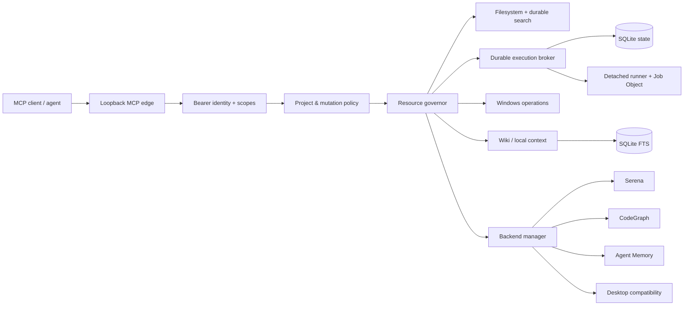

# Smart Assistant MCP

[](https://github.com/mehdisafer/smart-assistant-mcp/actions/workflows/windows.yml)


**Turn a Windows developer workstation into a controlled MCP runtime for AI agents.**

Smart Assistant MCP is a Windows-first MCP server focused on safe local development workflows: scoped filesystem access, durable command execution, bounded search, Windows operations, resource governance, and optional code/context backends.

It is designed for developers who want more than a thin collection of MCP tools. The runtime adds a control plane around local capabilities so agents can work on a workstation without treating unrestricted shell access as the default.

> Current public release target: **v0.1.0** · Python 3.12 · Apache-2.0 · Windows-first

## What it demonstrates

This repository is both a usable MCP runtime and a reference implementation for several engineering problems that appear when agents are allowed to interact with a real developer machine:

- **37 MCP tools** exposed through one governed endpoint;
- **project-scoped filesystem access** with traversal, symlink/reparse-point, and secret-path protections;
- **durable process execution** that survives HTTP disconnects;
- **idempotent mutations** and optimistic SHA-256 concurrency checks;
- **persistent bounded search sessions** with pagination and cancellation;
- **Windows-native process, service, port, and scheduled-task inspection**;
- **resource admission control** across RAM, CPU, disk, and optional GPU pressure;
- **runtime capability truth** that separates configured, available, and verified integrations;
- optional **Serena**, **CodeGraph**, **Agent Memory**, and **Desktop Commander compatibility** backends.

Application-specific connectors and personal automation modules are intentionally outside the scope of this public repository.
## Architecture



The important boundary is deliberate: **project scoping is an application guardrail, not an operating-system sandbox**. Native commands execute with the rights of the Windows account running the service.

For the complete design, see [docs/ARCHITECTURE.md](docs/ARCHITECTURE.md).

## Why a control plane matters

A basic MCP server can expose `read_file` or `run_command`. A workstation runtime needs more guarantees.

| Problem | Smart Assistant MCP approach |
|---|---|
| Retried agent mutations | Caller-supplied idempotency keys |
| Concurrent file edits | SHA-256 optimistic version checks |
| HTTP disconnect during a job | Durable execution state + persisted output |
| Large searches | Bounded persistent search sessions |
| Memory pressure | Admission lanes and resource governor |
| Backend tool sprawl | Explicit per-backend allowlists |
| Project escape | Canonical path validation + reparse-point rejection |
| Ambiguous capability state | Configured / available / verified separation |
| Service administration | Explicit service registry + mutation gates |
## Demo scenarios

### 1. Inspect a codebase without exposing the whole machine

Register one directory as a project, then use the built-in filesystem tools to list, read, and search it. Paths are relative to the project root and protected locations such as `.ssh`, `.aws`, `.azure`, `.env`, credential directories, and Git internals are rejected.

### 2. Start work once, reconnect later

`execution_start` persists an accepted command before it runs. The client can disconnect, reconnect, list executions, and continue reading stdout/stderr using byte cursors.

For synchronous-feeling workflows, `execution_run` submits through the same durable broker, waits briefly, and returns the current state without creating a second execution path.

### 3. Add developer intelligence as optional backends

The runtime can front external MCP processes such as Serena, CodeGraph, and Agent Memory. Each backend is independently enabled, resource-bounded, and restricted to an explicit tool allowlist.

See [docs/INTEGRATIONS.md](docs/INTEGRATIONS.md) for the qualification model.

## Public capability groups

| Area | Examples |
|---|---|
| Runtime | `runtime_health`, `capabilities_status`, `operational_metrics` |
| Filesystem | `filesystem_read`, `filesystem_list`, `filesystem_search`, `filesystem_write` |
| Durable search | `search_start`, `search_results`, `search_list`, `search_stop` |
| Execution | `execution_start`, `execution_run`, `execution_read`, `execution_cancel`, `execution_input` |
| Windows | `process_inspect`, `service_status`, `port_probe`, `scheduled_task_status` |
| Daemons | `daemon_start`, `daemon_stop`, `daemon_restart`, `daemon_status` |
| Context | `wiki_search`, `wiki_read`, `wiki_refresh` |
| Backends | `backend_tools`, `backend_call`, `capability_probe` |

The complete catalog is in [docs/CAPABILITIES.md](docs/CAPABILITIES.md).
## Quick start

Requirements:

- Windows 10/11;
- Python 3.12;
- PowerShell;
- optional external backends installed separately.

```powershell
git clone https://github.com/mehdisafer/smart-assistant-mcp.git
cd smart-assistant-mcp

python -m venv .venv
.\.venv\Scripts\python.exe -m pip install --upgrade "pip>=26.2"
.\.venv\Scripts\python.exe -m pip install -e ".[test]"

.\scripts\bootstrap.ps1
.\scripts\run-local.ps1
```

The bootstrap creates:

- a local `workspace/`;
- `config/runtime.json` from the safe example;
- a random bearer token whose SHA-256 digest is stored in the ignored identity registry.

The token is displayed once. Store it in the MCP client or a secret manager.

The default configuration binds only to `127.0.0.1`, exposes only the local `workspace` project, disables process termination, and leaves every optional backend disabled.

## Security posture

The public configuration is intentionally conservative:

- loopback-only server;
- no direct public binding;
- explicit bearer identities and scopes;
- exact project grants, never wildcard project access;
- relative filesystem paths only;
- parent traversal and reparse points rejected;
- protected secret/config directories denied;
- process execution requires an absolute executable path;
- mutating projects are separately allowlisted;
- higher-risk process termination is disabled by default;
- third-party backends are disabled until explicitly configured.

Read [docs/SECURITY.md](docs/SECURITY.md) before enabling remote access or additional projects.
## Optional developer backends

Smart Assistant MCP does not vendor these projects. They run as independent MCP processes when explicitly enabled.

- **Serena** — symbol-aware navigation and LSP diagnostics.
- **CodeGraph** — repository-level graph exploration.
- **Agent Memory** — persistent historical/context retrieval.
- **Desktop Commander compatibility** — optional compatibility layer for richer file/document operations.

This separation keeps the core independently licensed and makes backend permissions visible in configuration.

See [THIRD_PARTY.md](THIRD_PARTY.md) and [docs/LICENSING.md](docs/LICENSING.md).

## Engineering status

The public `v0.1.0` baseline is intended to establish a clean, reproducible core rather than claim complete workstation automation.

Validated before publication:

- clean Python 3.12 installation;
- source compilation;
- public regression tests;
- Bandit with **0 medium / 0 high** findings;
- dependency audit with **no known vulnerabilities** after packaging-tool upgrade;
- secret/private-environment scans on tracked files and Git history;
- Apache-2.0 package metadata and wheel inclusion.

Remaining work is tracked in [docs/PUBLICATION_ROADMAP.md](docs/PUBLICATION_ROADMAP.md).

## Repository map

```text
src/smart_assistant_mcp/   MCP runtime and control plane
config/                    safe public configuration templates
scripts/                   bootstrap and local run scripts
tests/                     public regression tests
docs/                      architecture, security, integrations, roadmap
.github/workflows/         Windows CI
workspace/                 default isolated project root
```

## License

Smart Assistant MCP is licensed under the **Apache License 2.0**. See [LICENSE](LICENSE).

Third-party integrations remain governed by their own upstream licenses.
