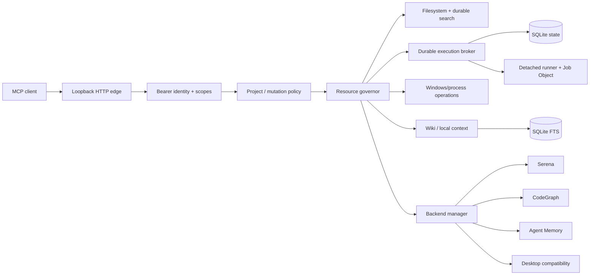

# Architecture

## Main layers

### MCP edge

The server uses MCP Python SDK v2 over Streamable HTTP and is hard-gated to loopback. Static bearer authentication is intentionally local; remote exposure must be provided by a separate authenticated ingress.

### Authorization and project policy

Each bearer identity maps to scopes and a project allowlist. Read/write project access is checked independently from OS process permissions.

### Resource governor

Every operation is admitted into a resource lane. Interactive low-cost work remains available under pressure while expensive/background work can be refused.

### Durable execution

Accepted commands are persisted before execution. Jobs survive HTTP disconnects and use idempotency keys to prevent duplicate mutation on retry. Output is journaled to disk and read with byte cursors.

### Context backends

Serena, CodeGraph and Agent Memory are treated as independent MCP processes with explicit tool allowlists, bounded queues and a warm-pool lifecycle.

### Windows operations

Native process/service/task inspection avoids shelling out where practical. Mutating operations are separately gated and disabled by default where risk is higher.

## Non-goals

- pretending that cwd/project scoping is a Windows security sandbox;
- transparently exposing every tool from every backend;
- bundling third-party MCP implementations into this repository;
- publishing private Smart Assistant connectors or credentials.
